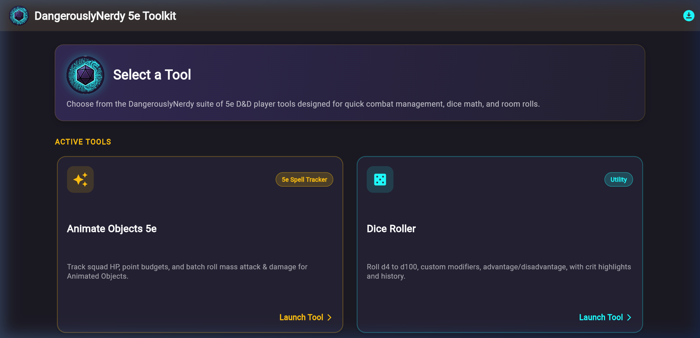

# DangerouslyNerdy 5e Toolkit

A free, open-source, local-first toolkit for running and playing 5e games: character builder and sheet, DM dashboard, shared campaign rooms with a battle map, dice rooms and compendiums. Available live at [5e.dangerouslynerdy.com](https://5e.dangerouslynerdy.com).

[](https://github.com/kevinburkeland/dangerously_nerdy_5e_toolkit/actions/workflows/release.yml)
[](LICENSE)
[](LEGAL_ATTRIBUTION_MODAL.md)



## What it does

- **Character Builder & Sheet**: Interactive character creation and sheet supporting 2014 RAW and 2024 Revised rules.
- **DM Dashboard**: Encounter tracker, monster stat blocks, combat controls, and party overview.
- **Campaign Rooms & Battle Map**: Shared party rooms with grid battle maps, token placement, and real-time state sync.
- **Polyhedral Dice Roller**: 3D physics dice roller with formula parsing and multiplayer rooms.
- **Spellbook Companion**: Dual-ruleset spell browser with filtering, slot tracking, and upcasting.
- **Compendiums & Codices**: Complete SRD references for classes, species, feats, items, and monsters.
- **Simulators & Calculators**: Monster arena Monte Carlo simulations and DPR damage visualizer.
- **Homebrew Studio**: Custom content creation and compendium importer with an anti-corruption layer.

See [docs/FEATURES.md](docs/FEATURES.md) for the full list.

## How it's built

- [vtt-engine-core](https://github.com/kevinburkeland/vtt-engine-core): pure-Dart engine: CRDTs, clock, replica identity, ports.
- [vtt-ruleset-dnd5e](https://github.com/kevinburkeland/vtt-ruleset-dnd5e): pure-Dart 5e rules on the core.
- [dangerously_nerdy_5e_toolkit](https://github.com/kevinburkeland/dangerously_nerdy_5e_toolkit): Flutter web app: SRD data, sync, storage, UI.

The app pins both packages by exact git SHA.
Architecture details are documented in [docs/ARCHITECTURE.md](docs/ARCHITECTURE.md).
Data safety and replication protocols are documented in [docs/DATA_SAFETY_AND_CRDT.md](docs/DATA_SAFETY_AND_CRDT.md).
Local-first, no accounts required: all campaign data is stored locally in IndexedDB and synchronized peer-to-peer.

## Run it locally

```bash
git clone https://github.com/kevinburkeland/dangerously_nerdy_5e_toolkit.git
cd dangerously_nerdy_5e_toolkit
flutter pub get --enforce-lockfile
flutter run -d chrome
```

The Flutter version comes from `pubspec.yaml` (`environment: flutter:`).
Tests:
```bash
flutter analyze
flutter test
```

## Contributing

Please see [CONTRIBUTING.md](CONTRIBUTING.md) (DCO sign-off, `git commit -s`) and [CODE_OF_CONDUCT.md](CODE_OF_CONDUCT.md).
The AI implementer follows the rules in [AGENTS.md](AGENTS.md) and [.agents/rules/](.agents/rules/).

## How this was made

The code in these three repositories is written by an AI implementation agent (Google's Gemini, in Antigravity), directed by the maintainer, who doesn't write implementation code by hand. Each change is planned as a bounded, test-first slice. A separate AI reviewer (Anthropic's Claude) runs the tests and its own probes against every slice, and the maintainer decides what lands. Commit messages name the slice.

## License & Governance

- **Application Software (AGPL-3.0)**: The application codebase, architecture, simulation algorithms, and build scripts are licensed under the [GNU Affero General Public License v3.0 (AGPL-3.0)](LICENSE).
- **Game Content & Mechanics (CC-BY-4.0)**: Tabletop RPG rules, spell matrices, creature stat blocks, equipment tables, and game mechanics derived from the System Reference Document 5.1 & 5.2.1 are licensed under the [Creative Commons Attribution 4.0 International License (CC-BY-4.0)](LEGAL_ATTRIBUTION_MODAL.md).
- **Developer Certificate of Origin (DCO)**: Contributions are governed by the [Developer Certificate of Origin](CONTRIBUTING.md) under an inbound=outbound model with decentralized copyright ownership.
- **Privacy Policy**: View our [Privacy Policy](PRIVACY_POLICY.md).
- **Terms of Service**: View our [Terms of Service](TERMS_OF_SERVICE.md).
